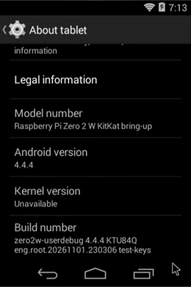

# Droid2W

Experimental Android ports for the **Raspberry Pi Zero 2 W**.

The current implementation targets **AOSP Android 4.4.4 (KitKat)** with a
32-bit Raspberry Pi Linux 5.10 kernel. This repository contains the device
configuration, source preparation scripts and build/image assembly tools;
it does not vendor the full Android or Linux source trees.

## Hardware status

Verified on one physical Zero 2 W during development:

| Component | Status |
| --- | --- |
| Android boot, Launcher and Settings | Working |
| HDMI output | Working at 1280×720 |
| Logical Android display | 320×480 tested; configured on the installed system |
| Graphics | Software GLES 1.x; GPU acceleration not implemented |
| USB keyboard/mouse | Working in USB host mode, reported by hardware tester |
| USB ADB | Working in peripheral mode |
| Wi-Fi | Scanning, WPA2 connection, DHCP, DNS and internet tested |
| ADB over Wi-Fi | Tested, including after reboot; key authentication enabled |
| Audio, Bluetooth, camera, cellular modem | Not brought up / not validated |

These results describe an incrementally updated development card. A clean
image rebuilt from this repository still needs independent hardware validation.
No downloadable release or performance claim is made by this initial commit.

## USB modes

The Zero 2 W has one USB controller. Use USB host mode for a keyboard/mouse
and Wi-Fi for ADB. Use peripheral mode for a direct USB ADB connection.
An underside USB-A addon uses the same controller.

The default boot profile is peripheral mode. A separate host profile is
provided. Disconnect the computer's USB data cable before booting host mode;
power the board through **PWR IN** and connect input devices through USB OTG.

## Development

- [Build guide](docs/BUILD.md)
- [Architecture and known limitations](docs/ARCHITECTURE.md)
- [Roadmap](docs/ROADMAP.md)
- [Basic apps and runtime update](docs/RUNTIME-UPDATE.md)
- [Русское описание](docs/README.ru.md)
- [Third-party notices](NOTICE.md)

Android 2.3.7 is a proposed future port, **not implemented**. The current working
baseline remains Android 4.4.4. The repository does not include Google apps,
Google Play services, personal ADB keys, network credentials or prebuilt images.

## Contributions

Include the board revision, exact source revisions, USB mode, reproduction
steps and relevant logs with reports. Remove passwords, keys, SSIDs and personal
addresses from logs before publishing. See [CONTRIBUTING.md](CONTRIBUTING.md).

This is an early development project. Android 4.4.4 and the legacy build
environment are obsolete; the bring-up uses permissive SELinux.
